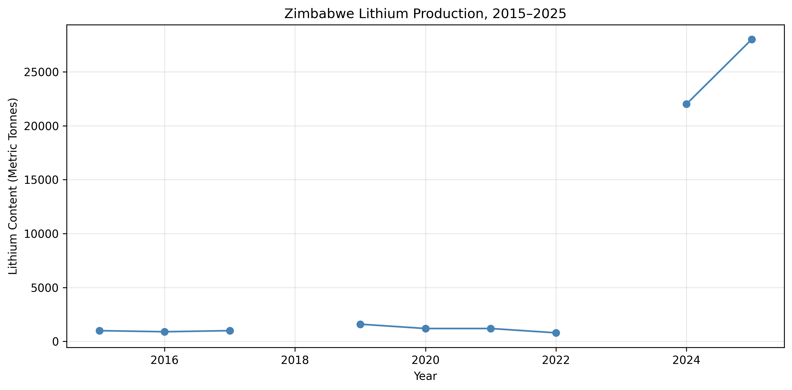
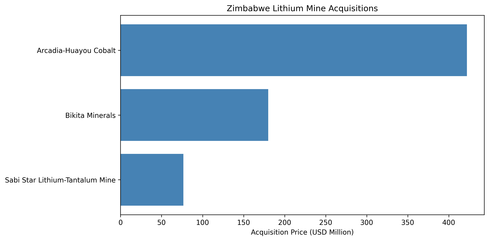
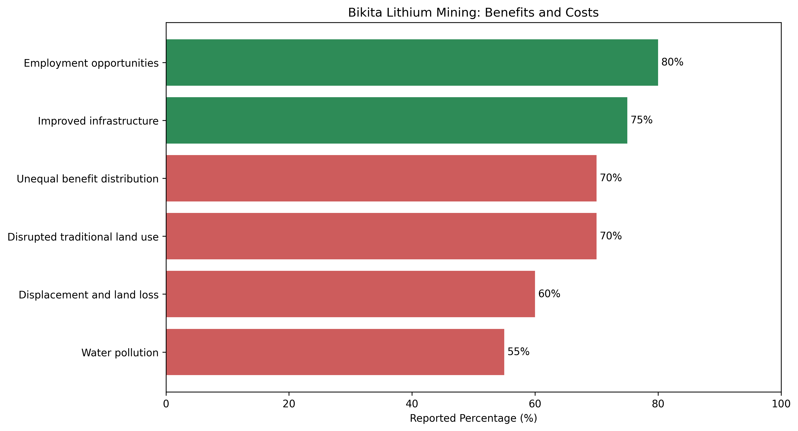
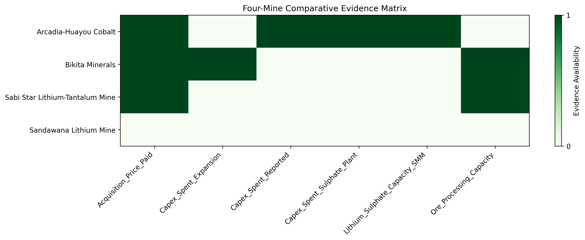

# Zimbabwe Lithium Governance Research

### An Interactive Research Dashboard and Python-Based Evidence Database

**Critical Minerals | Political Economy | Green Extractivism | Climate Justice | Data Analytics**

## Explore the Interactive Dashboard

[Launch the Zimbabwe Lithium Governance Dashboard](https://krishnadwi18.github.io/Zimbabwe-Lithium-Governance-Research/)

The dashboard provides an interactive platform for exploring foreign investment, mineral beneficiation, national production, policy developments and climate justice in Zimbabwe's lithium sector.

## Project Overview

This interdisciplinary research project combines international political economy, African Studies and computational social science to examine Zimbabwe's emerging lithium industry within the global green energy transition.

The project is aligned with my doctoral research:

**Green Extractivism and Climate Justice: A Case Study of Lithium Governance in Zimbabwe (2015–2026).**

## Mining Case Studies

| Project | Research Focus |
|---|---|
| Arcadia | Foreign investment and downstream processing |
| Bikita Minerals | Mining expansion and community impacts |
| Sabi Star | Investment and processing capacity |
| Sandawana | Domestic beneficiation and evidence gaps |

## Research Objectives

- Examine Zimbabwe's position within the global lithium value chain.
- Analyse foreign investment and domestic beneficiation.
- Track regulatory developments and policy implementation.
- Investigate distributive, procedural and recognition justice.
- Develop transparent and reproducible research workflows.

## Research Database and Outputs

| Component | Current Coverage |
|---|---:|
| Mining case studies | 4 |
| Mine-level observations | 31 |
| Documentary sources | 39 |
| Qualitative evidence records | 21 |
| Analytical datasets | 12 |
| Research visualisations | 8 |
| Interactive dashboard | 1 |

## Interactive Dashboard Features

- Research overview and key performance indicators
- Project-level investment and processing analysis
- National lithium production trends
- Climate justice and community participation
- Policy timeline and documentary evidence
- Interactive project and verification filters
- Searchable research database
- Filtered CSV exports
- Responsive design and light/dark modes

## Research Methodology

The project combines structured secondary-source research, evidence auditing, descriptive statistics, exploratory data analysis and comparative case-study analysis.

Observations are classified according to source reliability, verification status, measurement units and whether they represent actual outcomes, reported capacities or planned investments.

## Selected Research Visualisations

### National Lithium Production

### Foreign Investment

### Climate Justice

### Comparative Evidence Availability

## Technical Skills Demonstrated

- Python programming
- Pandas and NumPy
- Matplotlib and scientific visualisation
- Exploratory data analysis
- Research database development
- Data cleaning and quality validation
- Evidence classification and source tracking
- HTML, CSS and JavaScript dashboard integration
- Google Colab and GitHub
- Research documentation

## Repository Structure

| Directory | Description |
|---|---|
| data/ | Structured research datasets |
| evidence/ | Documentary evidence and source verification |
| notebooks/ | Python research and analysis notebooks |
| outputs/charts/ | Research visualisations |
| outputs/tables/ | Analytical datasets |
| reports/ | Preliminary research reports |
| src/ | Reusable research scripts |
| index.html | Interactive research dashboard |

## Methodological Limitations

- Missing observations do not indicate zero economic activity.
- Processing capacity should not be interpreted as actual production.
- Acquisition expenditure is distinct from productive capital investment.
- Community survey findings are not nationally representative.
- Descriptive associations do not establish causal relationships.
- Source verification and evidence corroboration remain ongoing.

## Future Development

- Expansion of primary-source evidence
- Longitudinal policy analysis
- Fieldwork and stakeholder interviews in Zimbabwe
- Cross-case climate justice assessment
- Global value-chain analysis
- Integration of additional trade and production datasets

## Researcher

**Krishnakant Dwivedi**

PhD Candidate, Centre for African Studies  
School of International Studies  
Jawaharlal Nehru University, New Delhi, India

**Research Interests:** African Studies, International Relations, Critical Minerals, Political Economy, Green Extractivism and Climate Justice.

## Disclaimer

This repository represents ongoing academic research. The datasets, dashboard and visualisations are preliminary analytical outputs and should not be treated as definitive assessments of Zimbabwe's lithium sector. All figures should be checked against their original sources before academic or policy use.
